<div align="center">


# Go2FGym

**Pick. Lift. Log.**

Your strength coach in your pocket: tap the muscles you want to train, see how every exercise is done, log your sets, and let the optional AI coach build your next workout.<br>An iPhone and iPad app for [Scriptable](https://scriptable.app). One file, no server, no sign-up.

[](CHANGELOG.md)
[](https://apps.apple.com/app/scriptable/id1405459188)
[](#ai)
[](docs/BLUEPRINTS.md)
[](https://github.com/gadominas/Go2FGym/commits)
[](LICENSE)

</div>

<p align="center">
  
  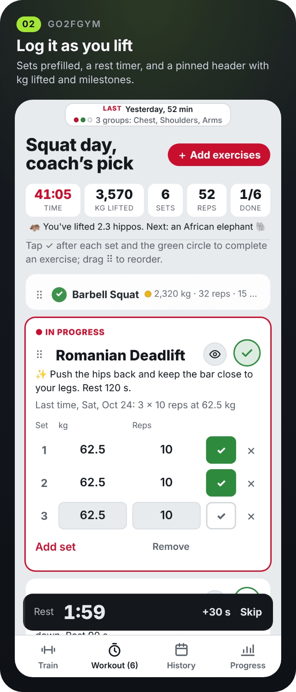
  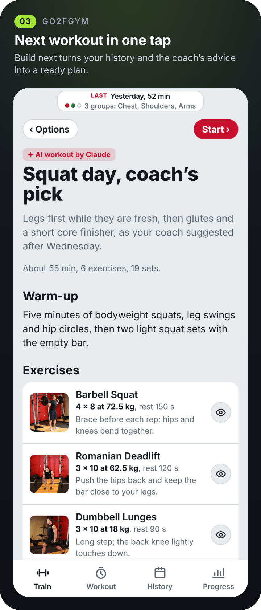
</p>

> [!NOTE]
> Screenshots are rendered from the app's real interface with invented sample data. Exercise photos and steps are from [free-exercise-db](https://github.com/yuhonas/free-exercise-db) (public domain).

> [!IMPORTANT]
> **Health and safety.** Use Go2FGym and do these exercises entirely at your own risk. It is not medical, physiotherapy or coaching advice. See [Disclaimer](#disclaimer).

## Highlights

Go2FGym is short for **Go to the f\*\*\*g gym**. It starts from what you have: it only shows exercises you can do with your equipment, shows each one moving, prefills your sets from last time and keeps the whole workout on one screen.

- **Pick by muscle.** Tap the plates for chest, back, legs, shoulders, arms, glutes or core; each plate shows how many exercises you can do. 466 exercises for bodyweight, dumbbells, barbell and bands; more equipment is a switch in Settings.
- **See it done.** A start-to-end photo demo and numbered steps for every exercise, or a quick 10-second preview with the eye button.
- **Log as you lift.** Weight and reps are prefilled from last time, and ✓ starts the rest timer. A pinned header shows the clock, kg lifted, sets, reps, exercises done, and what that weighs in grizzly bears, cows or cars.
- **Your order.** Drag exercises by the ⠿ handle or tap **↑ Up next**; the round green check folds a finished exercise into one line and moves on. An unfinished workout comes back when you reopen the app.
- **Next workout in one tap.** ✨ **Build next** turns your history and the coach's last advice into today's workout, with weights, sets and rest filled in.
- **Train anywhere.** A home bench and dumbbells, a hotel room on a business trip, or a gym with half the equipment: tell the AI coach what's there and get a workout that fits.
- **A coach after every workout.** A review of what went well, what to watch and what to train next, plus a Strava title and description in a **Serious**, **Funny** or **Neutral** tone.
- **See your progress.** A calendar with a dot per muscle group trained, weekly sets, muscle balance with the most-due group, your streak, and an estimated one-rep max trend for every main lift.
- **Your week on the Home Screen.** A widget with your last workout and this week's sessions, in every size and on the Lock Screen.
- **Free, private and offline.** No account, no subscription, no ads. The library lives on your iPhone, Settings apply at once, and new versions are offered in the app.

> Inspired by the early risers of the **[7AM Club](https://www.instagram.com/7amclub__/)** community.

## Screenshots

<p align="center">
  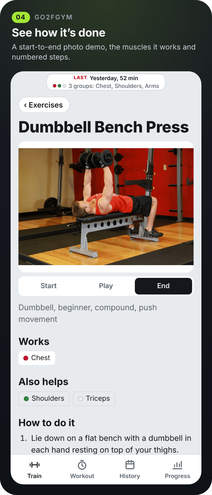
  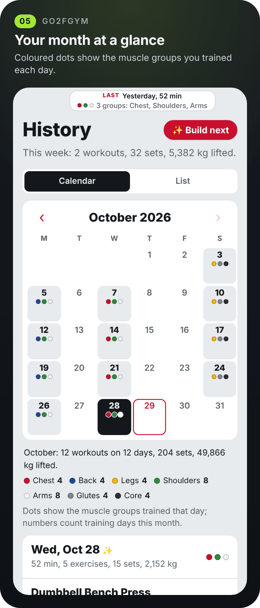
  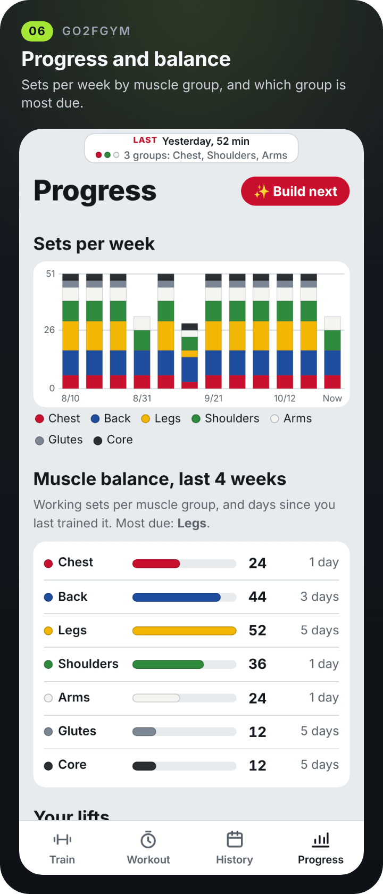
</p>
<p align="center">
  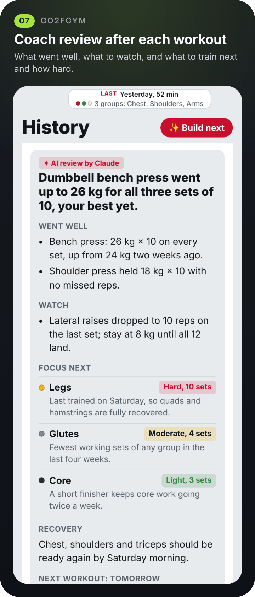
  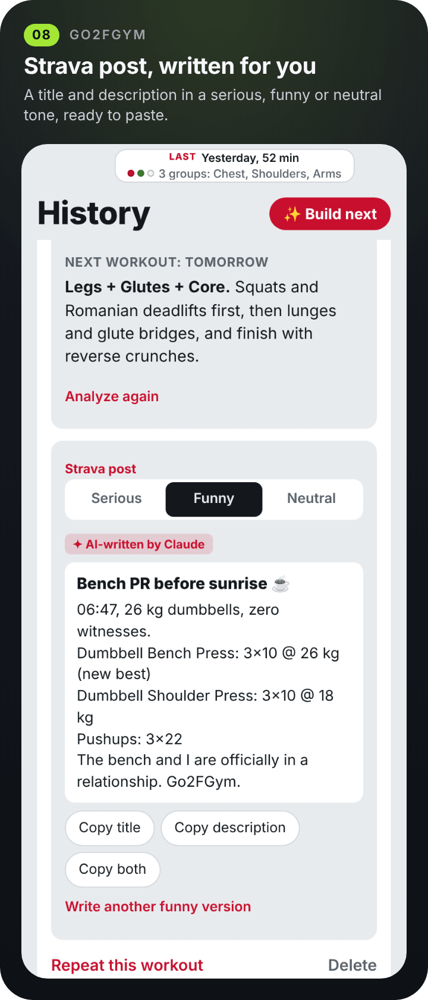
  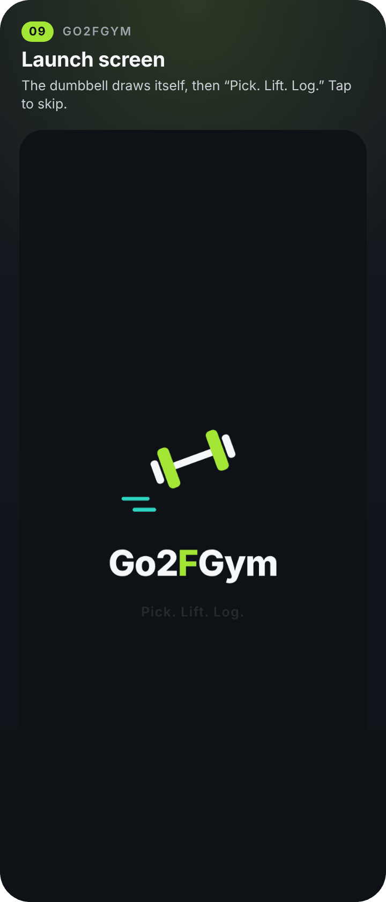
</p>
<p align="center">
  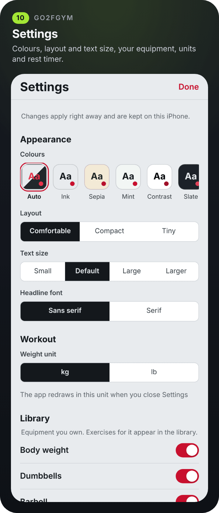
  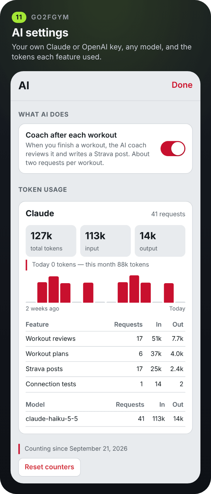
  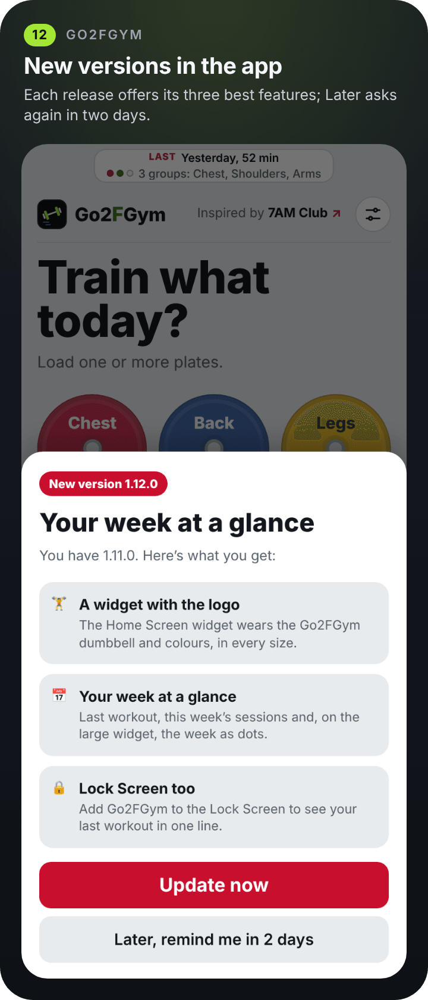
</p>
<p align="center">
  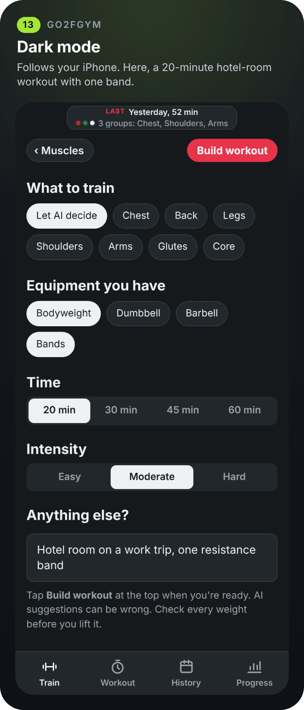
  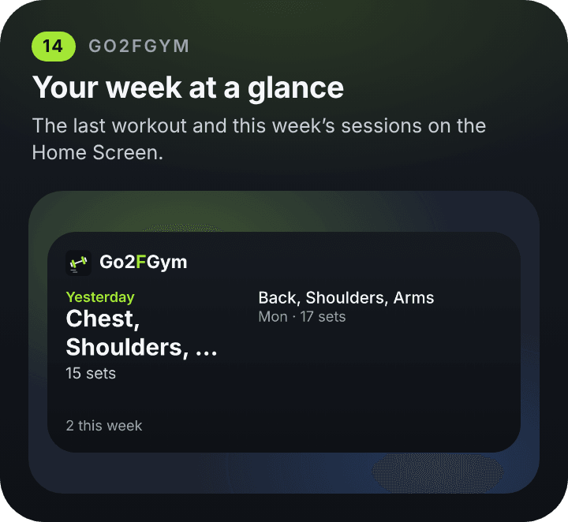
</p>

## Install

1. Get **[Scriptable](https://apps.apple.com/app/scriptable/id1405459188)** (free) on your iPhone or iPad.
2. In Scriptable tap **+**, paste this line and tap **▶︎**:
   ```js
   const s = await new Request("https://raw.githubusercontent.com/gadominas/Go2FGym/main/install.js").loadString(); await Function("module", "return (async () => {" + s + "\n})()")(module);
   ```
3. Tap **Open now**, accept the disclaimer, and tap **Download library** on Wi-Fi (about 36 MB, once).

That's it. From then on Go2FGym works offline and updates itself: new versions are offered right in the app, and your workouts, library and settings are kept. For a Home Screen icon, tap *⋯* on *Go2FGym* in Scriptable, then *Add to Home Screen*. Widget, extra equipment, backups and troubleshooting are in the **[install guide](docs/INSTALL.md)**.

<details>
<summary><b>Install by hand</b></summary>

- **Download the file:** save [`Go2FGym.js`](Go2FGym.js) to **iCloud Drive › Scriptable**. It shows up in Scriptable automatically.
- **Or copy and paste:** in Scriptable, tap **+**, paste the whole of `Go2FGym.js`, and name the script *Go2FGym*.

Then run it, accept the disclaimer and tap **Download library**. Keep the screen open until it says the library is ready; if it's interrupted, tap **Download library** or **Update library** again and photos you already have are skipped.

</details>

You need:

- an iPhone or iPad with about 40 MB of free space;
- optionally, a Claude or OpenAI API key for the AI coach (see [AI](#ai)).

## How to use it

The hardest part of training isn't the lifting, it's everything around it: deciding what to do today, remembering what you lifted last week, guessing whether the form is right. And most gym apps assume a full commercial gym.

### Train

Tap one or more plates on the **Train** tab, then **Show exercises**. Narrow the list with the muscle, equipment and type chips, or search. Tap an exercise to see it done (**Start**, **Play** and **End** control the demo), and **+** or **Add to workout** to add it.

On the **Workout** tab, check weight and reps and tap **✓** after each set; leave the weight empty for bodyweight. **Add set** copies the previous one, **×** removes one. Tap an exercise to mark it **In progress**, and the round green **✓** in its corner to complete it. **Finish workout**, then tap again to save.

### Let the AI coach plan

- **Build next.** Tap **✨ Build next** at the top of History or Progress. No form, no choices: Go2FGym takes the muscle groups your coach suggested after your last session (or the ones you've trained least lately), your usual workout length and all your equipment, and builds a ready-to-start plan with sets, reps, rest and weights from what you lifted last time. Check it, tap **Start ›**, and lift.
- **Build a workout.** Open **✨ Build a workout with AI** on the Train tab, pick what to train (or **Let AI decide**), switch on only the equipment that's there, pick 20 to 60 minutes and **Easy**, **Moderate** or **Hard**, add a note if you like (*"hotel room on a work trip"*, *"lower back is sore"*), and tap **Build workout**. Check the plan, then **Start this workout**.
- **After every workout.** After **Finish workout** the AI coach reviews it and writes a Strava title and description. Both are saved with the workout in **History**.

### Track your progress

**History** shows your month as a calendar with coloured dots for the muscle groups trained each day; tap a day to see the workout set by set, **Repeat this workout**, the AI review and the Strava post. **Progress** shows weekly sets by muscle group, muscle balance with the most-due group, your streak, and a trend for every main lift; tap a lift for its details.

<details>
<summary><b>Every task, step by step</b></summary>

| To… | Do this |
|---|---|
| Choose what to train | Tap one or more plates, then **Show exercises** |
| Narrow the list | Use the muscle, equipment and type chips, or search |
| See how it's done | Tap an exercise. **Start**, **Play** and **End** control the demo. |
| Add to today's workout | Tap **+** in the list, or **Add to workout** on the exercise |
| Add more during a workout | **＋ Add exercises** at the top of the Workout tab, tap **+**, then **✓ Workout** at the top to go back |
| Change the order of exercises | Drag the **⠿** handle, or tap **↑ Up next** on the one you want to do next |
| Finish an exercise | The round green **✓** in its top-right corner |
| Check a finished exercise | Tap its one-line summary to see the sets; **↺ Resume** to keep working on it |
| Quickly see how an exercise is done | Tap the **eye** next to it in your workout or a built plan; **Open exercise** for the full page |
| Log a set | Check weight and reps, then tap **✓**. Leave weight empty for bodyweight. |
| Add or remove a set | **Add set** copies the previous one; **×** removes a set |
| Finish | **Finish workout**, then tap again to save |
| Do a past workout again | **History**, open the workout, **Repeat this workout** |
| Let AI build a workout | **Train › ✨ Build a workout with AI** |
| Get your next workout in one tap | **✨ Build next** at the top of History or Progress. It uses the coach's last suggestion (or your most-due muscles), your usual workout length and all your equipment, and goes straight to the plan. **‹ Options** adjusts it; **Start ›** or **Start and add exercises** begins it. |
| Get AI feedback on a past workout | **History**, open it, **✨ Analyze with AI coach** |
| See your month | **History › Calendar**, tap a day; **‹ ›** change month |
| See your trends | **Progress** tab; tap a lift for its details |
| Post to Strava | **History**, open the workout, pick **Serious**, **Funny** or **Neutral** under *Strava post*, then **Copy both** |
| Export | **History › Export CSV** |
| Get new exercises or missing photos | **Train › Update library** (bottom of the Train screen) |
| Change look, units, equipment or rest time | The **sliders icon** at the top of the Train tab |
| Read the disclaimer again | **Train › Disclaimer** (bottom of the Train screen) |
| Update the app | **Update now** on the update sheet, or **Settings › Updates › Check for updates now** |

</details>

## Widget

The widget wears the Go2FGym logo and shows your last workout (Today, Yesterday or how many days ago, its muscle groups and sets) and how many you've done this week. Medium adds this week's other workouts; large also shows the week as dots, Monday to Sunday. Tapping it opens the app. It is the shared [widgets](https://github.com/gadominas/app-blueprints/blob/main/blueprints/widgets.md) blueprint, so all the apps' widgets look alike.

1. Long-press the Home Screen, tap **Edit › Add Widget**, choose **Scriptable** and a size.
2. Long-press the widget, tap **Edit Widget**, set **Script** to *Go2FGym* and **When Interacting** to *Run Script*.

Lock Screen widgets are added the same way under **Customize › Lock Screen**; they show your last workout in one line. The widget reads a small snapshot the app saves when it opens and after a workout is saved or deleted, so it is fast and works offline: open Go2FGym once after updating so it picks up your workouts. How often it asks iOS to refresh is in **Settings › Widget**.

## AI

The optional AI coach builds a workout from your options (**✨ Build a workout with AI**), builds your next one in one tap (**✨ Build next**), reviews each workout after you finish it, and writes a Strava title and description in the tone you pick. Everything the AI writes is labelled with the provider that wrote it.

- **Your own key.** Open **Settings › AI coach › AI settings**, add a [Claude](https://console.anthropic.com/settings/keys) or [OpenAI](https://platform.openai.com/api-keys) key, pick any model the key can use and tap **Test connection**.
- **Kept safe.** The key is typed into a native iOS prompt, stored in the iOS Keychain and sent only to its own provider. The app's page never sees it. Remove a key under **AI settings**.
- **You see the cost.** **AI settings › Token usage** shows tokens per day, feature and model. API use is billed by the provider, separately from any chat subscription.
- **Optional.** Everything else works without a key, and the AI buttons stay hidden until you add one. The Strava post's **Neutral** tone still works as a basic summary built on the phone, labelled “Template — no AI”. To stop the automatic review and Strava post after each workout, turn off the switch under **AI settings › What AI does**.

The AI only chooses exercises from your library, keeps weights at or close to what you lifted last time, and avoids loading anything you mention in the note. Check every weight anyway: it can be wrong.

**What's sent to the AI provider in use:** exercise names and muscles, your sets, weights and dates, the options you chose and your note. No name, account or location.

## Settings

Tap the sliders icon at the top of the Train tab. Changes apply at once and are saved in `settings.json` in iCloud Drive › Scriptable › Go2FGym, so updates never reset them. Your workouts and library stay where they were.

| Section | What you can change |
| --- | --- |
| Appearance | Colours (Auto or six palettes, Go2FGym red in all), layout (Comfortable, Compact, or Tiny: one line per exercise without photos and one line per workout in History), text size, headline font (the condensed Go2FGym font or serif) |
| Workout | Weight unit, kg or lb (shown and exported) |
| Library | The equipment you own (body weight, dumbbells, barbell, bands, kettlebells, E-Z curl bar, medicine ball, exercise ball, foam roller, other) and whether strongman and Olympic weightlifting exercises are included. After adding equipment, tap **Update library** to download its photos |
| History | Back up history to iCloud Drive › Scriptable › Go2FGym-backup |
| AI coach | AI settings (keys, models, token usage, and the “after each workout” switch) and the default Strava post tone |
| Updates | Offer new versions (**Later** waits two days) and **Check for updates now** |
| Timing, Downloads, Widget | Rest timer length (30–300 s, default 90), how many photos download at once (1–12, default 6) and how often the widget asks iOS to refresh (15–240 min, default 30), each with Reset. The widget's “out of date” setting is kept like in every app but has no effect here ([docs/BLUEPRINTS.md](docs/BLUEPRINTS.md)) |
| Built with | The shared blueprints this app follows, with links (read-only) |

## Updates and what's new

Go2FGym checks this repository for a new version each time it opens. When one is out, a sheet shows its three best features with **Update now** and **Later**; Later hides the offer for two days. Your data and settings are kept. Every release is in [CHANGELOG.md](CHANGELOG.md). After updating, close the app and open it again. The version you have is shown at the bottom of the Train screen. To turn the checks off, switch off **Settings › Updates › Offer new versions**.

On a copy older than 1.5.0, run the one-line installer again and tap **Update**.

## Privacy and security

- Everything stays on your phone: no account, no server, no tracking. History is a plain JSON file in Scriptable's local Go2FGym folder, with a copy in iCloud Drive › Scriptable › Go2FGym-backup if the backup is on.
- Network use: downloading the exercise library and its photos from GitHub, the app icon for the widget (once per version) and, only if you add a key, the AI coach requests to Claude or OpenAI described under [AI](#ai). The **Inspired by 7AM Club** button opens Instagram only when you tap it.
- AI keys stay in the iOS Keychain and are only sent to their own provider.
- The update check only downloads `releases.json` from this repository.

## How it works

Go2FGym is one file of plain JavaScript, HTML and CSS. Scriptable runs it and shows its interface in a web view; the page and the script talk through a small message queue, and the script does everything that needs files, the network or the Keychain.

<details>
<summary><b>Where your data lives</b></summary>

| What | Where |
|---|---|
| Library and photos | Scriptable's local folder, `Go2FGym/` (not backed up, re-download anytime) |
| Workout history | Scriptable's local folder, `Go2FGym/history.json` |
| History backup | **iCloud Drive › Scriptable › Go2FGym-backup › history.json**, updated after every save |
| CSV export | Same iCloud folder, `history.csv`, plus the share sheet |
| Settings | **iCloud Drive › Scriptable › Go2FGym › settings.json** |

**On a new phone**, install the script and run it. If the local history is missing and the iCloud backup exists, it's restored automatically. Then tap **Download library** again.

</details>

## Troubleshooting

| Problem | Try this |
| --- | --- |
| The download stopped or some photos failed | Tap **Update library** again. Only missing photos are downloaded. |
| An exercise says "Photos not downloaded" | Same: **Update library** |
| No beep when the rest timer ends | The beep follows the silent switch and volume. Turn the ringer on. |
| My workout disappeared after closing | Reopen the app; unfinished workouts are restored. A change made in the last second before closing might be lost. |
| History is empty after reinstalling | Check that **iCloud Drive › Scriptable › Go2FGym-backup › history.json** exists, then run the app again |
| A barbell exercise needs a squat rack I don't have | Skip it. The data doesn't separate rack and floor movements. |
| "AI coach: …" error | The message comes from the AI provider. Check your key has credit and that you're online, then try again; **Test connection** in AI settings checks the key. |
| The installer says "Download failed" | Check your connection. The script is downloaded from `raw.githubusercontent.com`. |

More is in the [install guide](docs/INSTALL.md). Still stuck? Open an issue with a screenshot.

## Built with

- **[Scriptable](https://scriptable.app)** by Simon Støvring: one JavaScript file, a WebView for the interface.
- **[app-blueprints](https://github.com/gadominas/app-blueprints)**: the shared in-app updates, settings, AI configuration, launch screen and widgets that every one of these apps uses, so they look and behave alike. **Settings › Built with** lists the versions; [docs/BLUEPRINTS.md](docs/BLUEPRINTS.md) adds the deviations.
- **[free-exercise-db](https://github.com/yuhonas/free-exercise-db)** by yuhonas: the exercise library (873 exercises with photos, steps, muscles and equipment), released into the public domain. Go2FGym downloads its `exercises.json` and photos once, then keeps them on your iPhone. It is based on **[exercises.json](https://github.com/wrkout/exercises.json)** by Ollie Jennings.
- **[Claude API](https://www.anthropic.com/api)** (Anthropic) and **[OpenAI API](https://platform.openai.com)**: the optional AI coach, with your own key.
- **[GitHub](https://github.com/gadominas/Go2FGym)**: hosts the app, the one-line installer and `releases.json` for in-app updates.

No other libraries: the whole app is one file of plain JavaScript, HTML and CSS.

Maintainers: release notes live in [`releases.json`](releases.json); see [docs/RELEASING.md](docs/RELEASING.md). Screenshots are regenerated with [repo-site](https://github.com/gadominas/app-blueprints/tree/main/repo-site) from [`docs/site/scenario.js`](docs/site/scenario.js).

## Disclaimer

**Use Go2FGym and do these exercises entirely at your own risk.** The app gives general exercise information, not medical, physiotherapy or coaching advice, and the exercise data may contain mistakes. Check with a doctor before you start, especially if you have an injury or a health condition, are pregnant, or haven't trained for a while. Learn each movement with light weights, warm up, use safety stops or a spotter for heavy barbell work, and stop straight away if you feel pain, dizziness or shortness of breath.

Workouts, weights and analysis from the optional AI coach are generated automatically by a language model, can be wrong, and are no substitute for a qualified coach or doctor. Check every weight before you lift it.

To the fullest extent permitted by law, the author is not responsible or liable for any injury, health problem, loss or damage arising from using the app or doing the exercises. The app asks you to accept this on first launch.

A personal project, provided as is, without warranty. Not affiliated with Strava, Anthropic or OpenAI.

## More apps like this

<p>
  <a href="https://github.com/gadominas/StravaFeed"></a>&nbsp;
  <a href="https://github.com/gadominas/BlogPulse"></a>&nbsp;
  <a href="https://github.com/gadominas/VisionX"></a>&nbsp;
  <a href="https://github.com/gadominas/Go2FGym"></a>&nbsp;
  <a href="https://github.com/gadominas/Tamo-"></a>&nbsp;
  <a href="https://github.com/gadominas/Reading-Stars"></a>
</p>

<sub>Strava Daily Digest · BlogPulse · VisionX · Go2FGym · Dienynas+ · Reading Stars, all single-file Scriptable apps built on the same blueprints.</sub>

## License

[MIT](LICENSE) © 2026 Gediminas Siutilas. Exercise data and photos are public domain.
