<p align="center">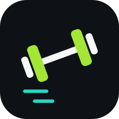</p>

<h1 align="center">Go2FGym</h1>
<p align="center"><b>Pick. Lift. Log.</b></p>

**Go to the f\*\*\*g gym.** Your strength coach in your pocket: open it, tap the muscles you want to train, and lift. Go2FGym shows you how every exercise is done, remembers what you lifted last time, and with one tap builds your next workout for you.

<p align="center">
  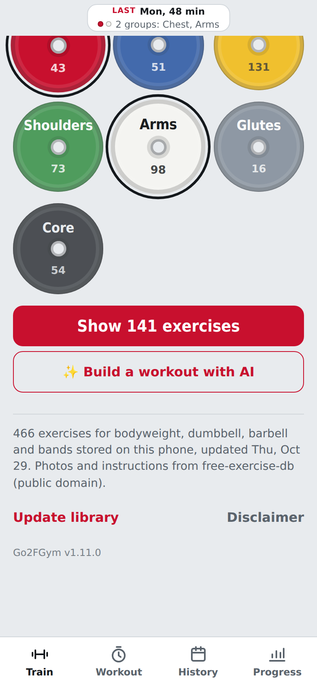
  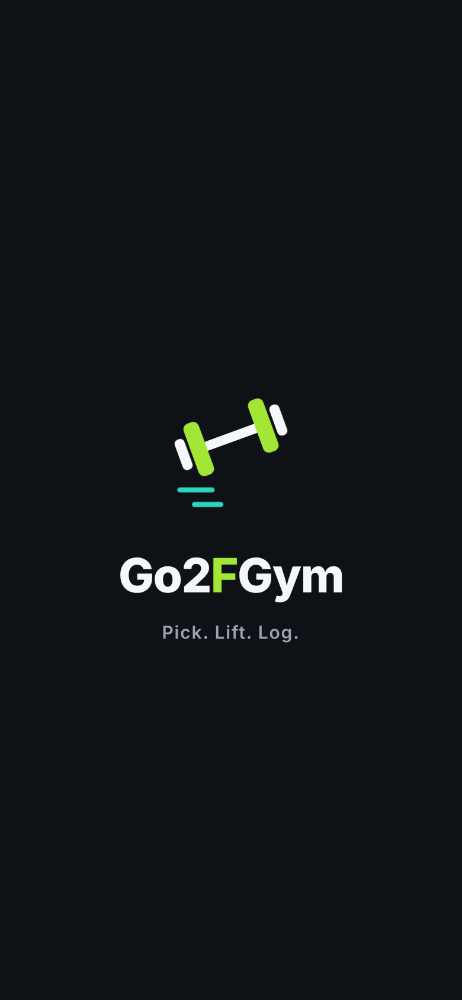
  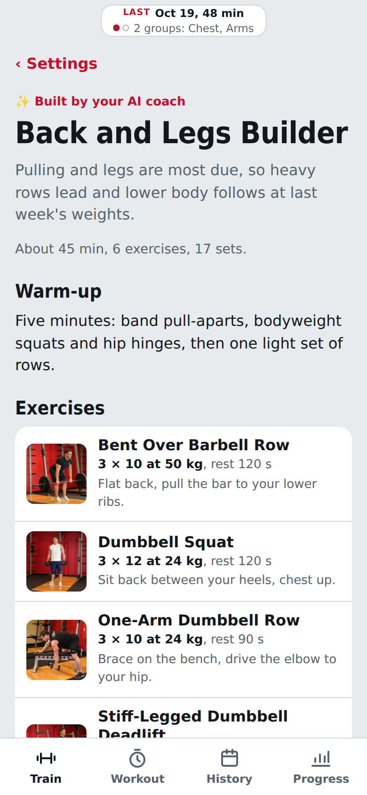
  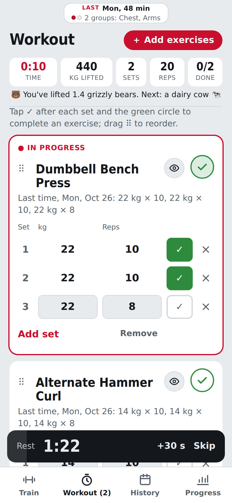
</p>

- **No more planning.** ✨ **Build next** turns your training history into today's workout in seconds. Weights, sets and rest are already filled in.
- **Built for what you actually have.** A home bench and dumbbells, a hotel room on a business trip, or a gym with half the equipment: tell it what's there and get a workout that fits.
- **Free, private and offline.** No account, no subscription, no ads. 466 exercises with photos live on your iPhone.

> Inspired by the early risers of the **[7AM Club](https://www.instagram.com/7amclub__/)** community.

## Install in a minute

1. Get the free **[Scriptable](https://apps.apple.com/app/scriptable/id1405459188)** app from the App Store.
2. In Scriptable tap **+**, paste this line and tap **▶︎**:
   ```js
   const s = await new Request("https://raw.githubusercontent.com/gadominas/Go2FGym/main/install.js").loadString(); await Function("module", "return (async () => {" + s + "\n})()")(module);
   ```
3. Tap **Open now**, accept the disclaimer, and tap **Download library** on Wi-Fi (about 36 MB, once).

That's it. From then on Go2FGym works offline and updates itself: new versions are offered right in the app. For a Home Screen icon, tap *⋯* on *Go2FGym* in Scriptable, then *Add to Home Screen*. Widget, extra equipment, backups and troubleshooting are in the **[install guide](docs/INSTALL.md)**.

## Why Go2FGym

The hardest part of training isn't the lifting, it's everything around it: deciding what to do today, remembering what you lifted last week, guessing whether the form is right. And most gym apps assume a full commercial gym.

Go2FGym starts from what you have. It only shows exercises you can do with your equipment, shows each one moving, prefills your sets from last time and keeps the whole workout on one screen. The optional AI coach goes further: it plans the session for you and tells you what to train next.

## ✨ Let the AI coach plan for you

### Build next: your next workout in one tap

Tap **✨ Build next** at the top of History or Progress. No form, no choices: Go2FGym takes the muscle groups your coach suggested after your last session (or the ones you've trained least lately), your usual workout length and all your equipment, and builds a ready-to-start plan with sets, reps, rest and weights from what you lifted last time. Check it, tap **Start ›**, and lift. The planning you'd otherwise do in the morning is done before you've put your shoes on.

### Train anywhere: business trips, hotel rooms, small gyms

Away from home, open **✨ Build a workout with AI**, switch on only what's there (bodyweight, a band, a pair of light dumbbells), pick 20 minutes and add a note like *"hotel room on a work trip"*. You get a complete workout made only of exercises you can actually do there.

### After every workout

The coach reviews each session: what went well, what to watch, which muscle groups to focus on next and how hard, and when you've recovered. It also writes a Strava title and description in a **Serious**, **Funny** or **Neutral** tone.

<table>
<tr><td align="center" valign="top" width="33%">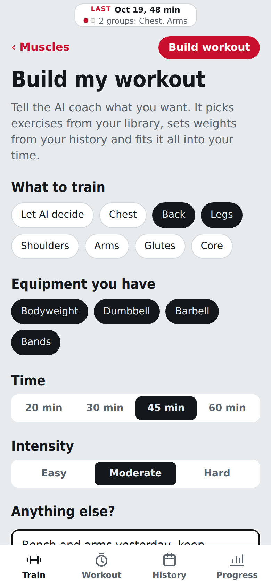<br><b>Build a workout</b><br><sub>Pick muscles, equipment, time and intensity; the AI does the rest.</sub></td><td align="center" valign="top" width="33%"><br><b>Your plan, ready</b><br><sub>Sets, reps, rest and weights from your own history.</sub></td><td align="center" valign="top" width="33%">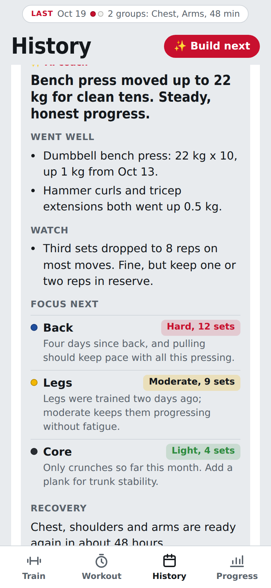<br><b>Post-workout review</b><br><sub>What went well, what's next, and how hard to go.</sub></td></tr>
<tr><td align="center" valign="top" width="33%">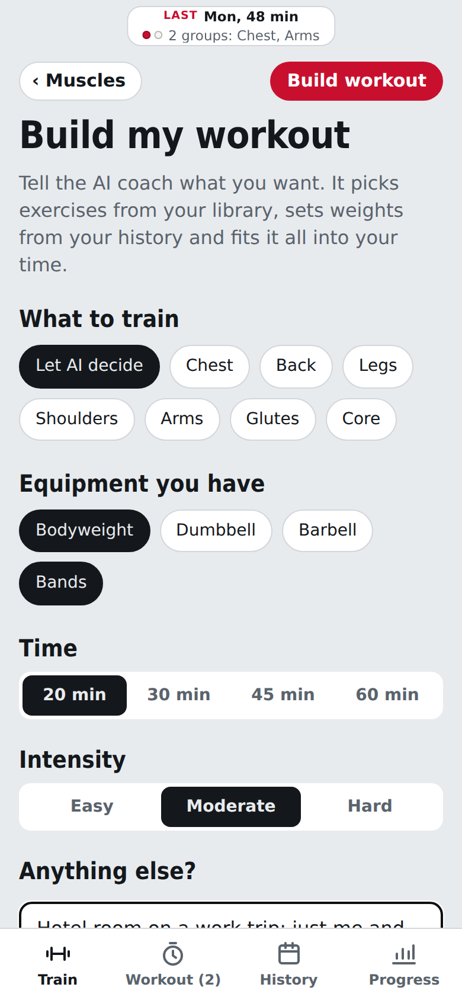<br><b>On the road</b><br><sub>Only bodyweight and a band in the hotel room? Say so.</sub></td><td align="center" valign="top" width="33%">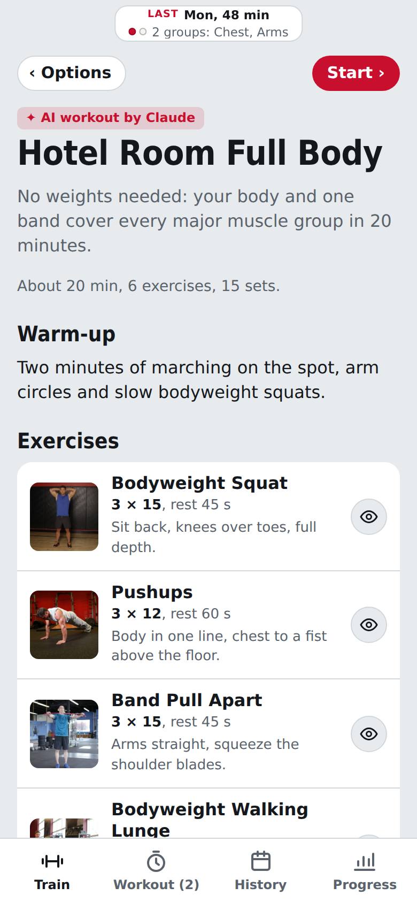<br><b>Hotel room workout</b><br><sub>A full-body plan with nothing but what you have.</sub></td><td align="center" valign="top" width="33%">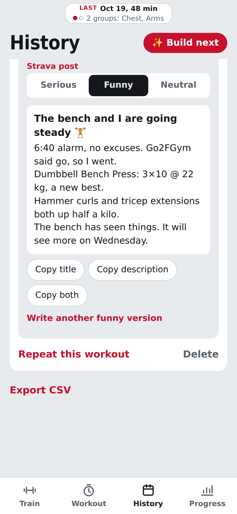<br><b>Strava post</b><br><sub>A title and description in your tone, ready to paste.</sub></td></tr>
</table>

The AI coach uses **Claude or OpenAI with your own API key** and is entirely optional; see [Setting up the AI coach](#setting-up-the-ai-coach).

## Feature tour

### Train

Pick muscles, see how it's done, log fast, and keep the workout flowing.

- **Pick by muscle:** tap the plates for chest, back, legs, shoulders, arms, glutes or core.
- **Made for home:** 466 exercises for bodyweight, dumbbells, barbell and bands. More equipment is a switch in Settings.
- **See it done:** a start-to-end photo demo and numbered steps for every exercise, or a quick 10-second preview with the eye button.
- **Fast logging:** weight and reps prefilled from last time; ✓ starts the rest timer.
- **Live workout header:** pinned at the top while you train: the clock, kg lifted, sets, reps, exercises done, and what that weighs in grizzly bears, cows or cars.
- **Your order:** drag exercises by the ⠿ handle, or **↑ Up next** for supersets. Tap an exercise to mark it **In progress**.
- **Complete and move on:** the round green check folds an exercise into one line (kg, reps, minutes) and jumps to the next one.
- **Nothing lost:** an unfinished workout comes back when you reopen the app.

<table>
<tr><td align="center" valign="top" width="33%"><br><b>Pick by muscle</b><br><sub>Tap the plates; the numbers are exercises you can do.</sub></td><td align="center" valign="top" width="33%">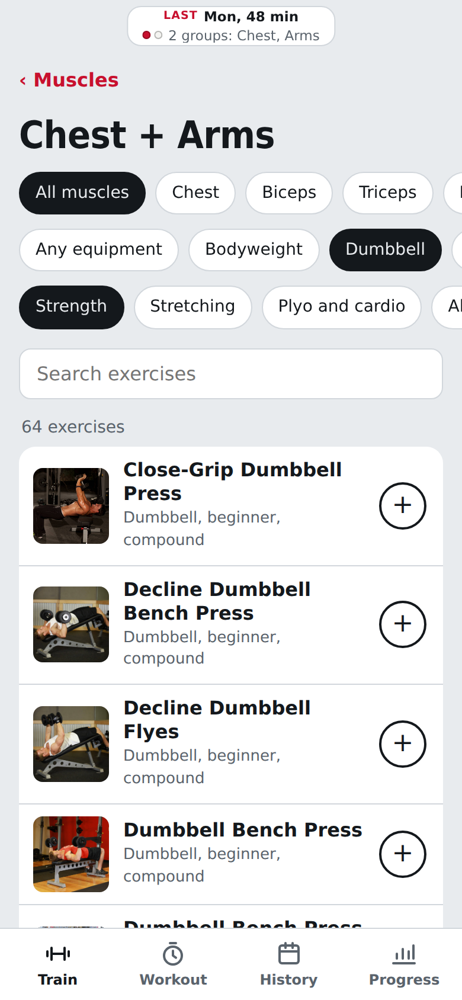<br><b>Only what you can do</b><br><sub>Filter by muscle, equipment and type.</sub></td><td align="center" valign="top" width="33%">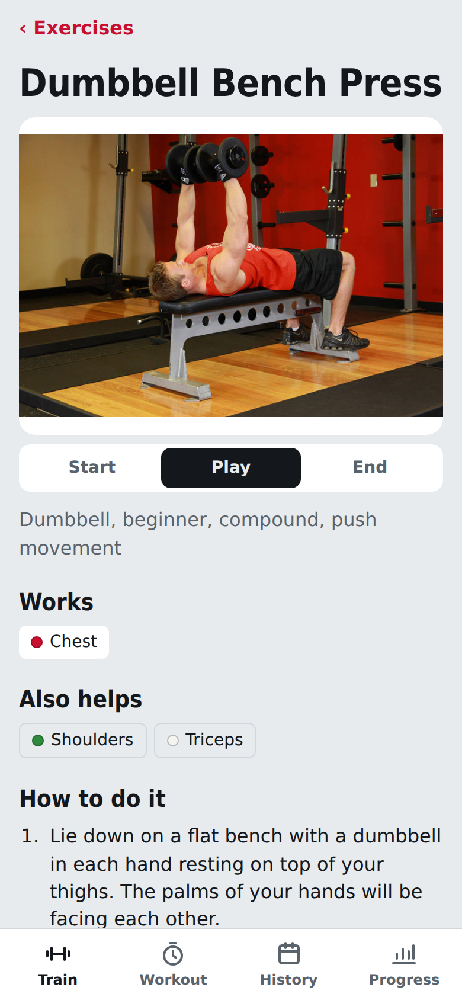<br><b>See it done</b><br><sub>A start-to-end photo demo for every exercise.</sub></td></tr>
<tr><td align="center" valign="top" width="33%">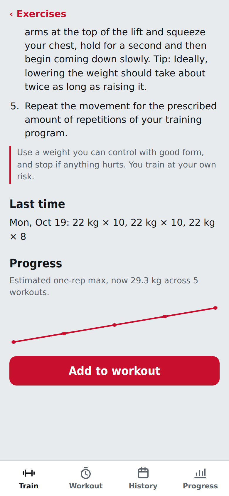<br><b>Steps and last time</b><br><sub>Numbered steps, your last session and your trend.</sub></td><td align="center" valign="top" width="33%"><br><b>Log in seconds</b><br><sub>A live clock and totals on top, prefilled sets below.</sub></td><td align="center" valign="top" width="33%">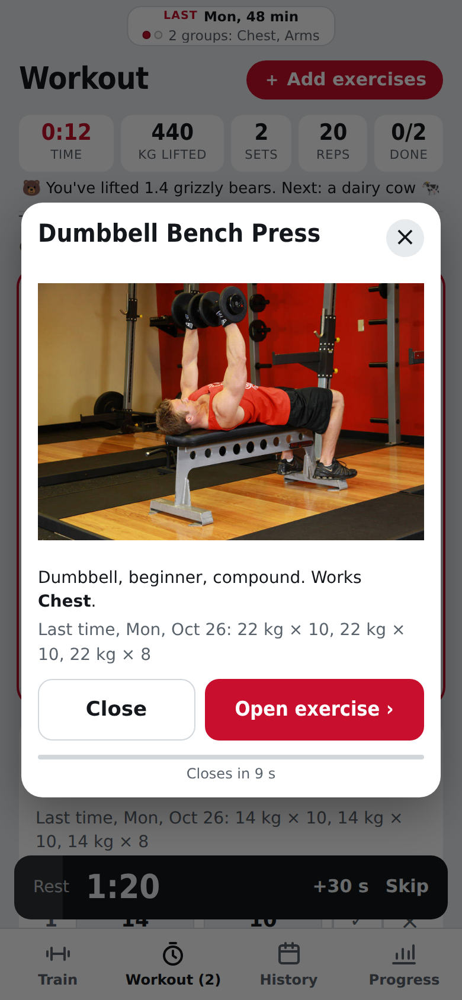<br><b>Quick preview</b><br><sub>The eye shows it moving; closes itself in 10 s.</sub></td></tr>
<tr><td align="center" valign="top" width="33%">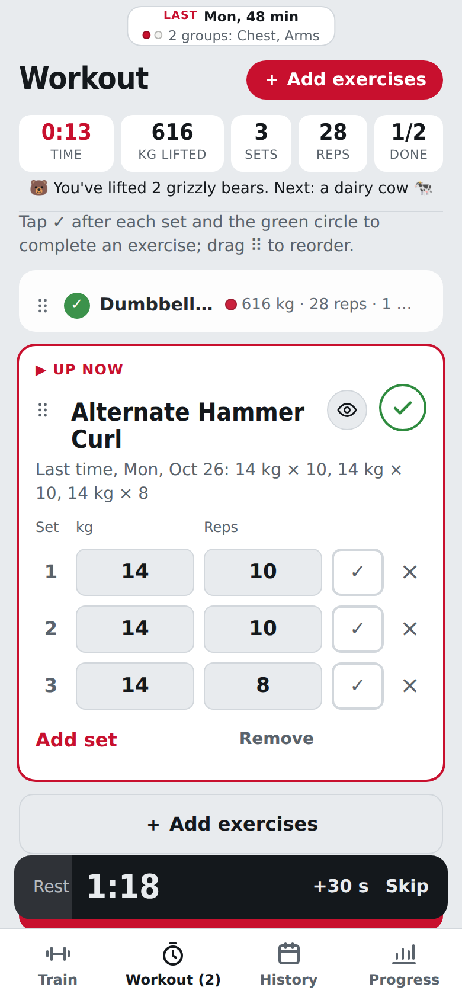<br><b>Complete and move on</b><br><sub>Done exercises fold into one line; the next lights up.</sub></td></tr>
</table>

### Track your progress

See your month at a glance and watch the numbers go up.

- **Calendar:** coloured dots show the muscle groups you trained each day.
- **Progress:** weekly sets by muscle group, muscle balance with the most-due group, your streak, and a trend for every main lift.
- **History:** every workout set by set, **Repeat this workout**, and CSV export.
- **Widget and last-workout chip:** your last session at a glance.

<table>
<tr><td align="center" valign="top" width="33%">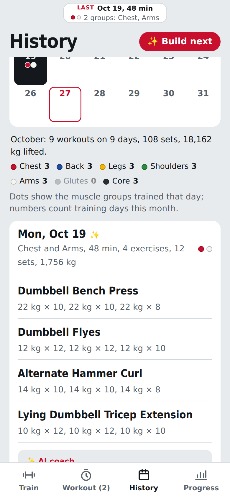<br><b>Calendar</b><br><sub>Dots for the muscle groups trained each day.</sub></td><td align="center" valign="top" width="33%">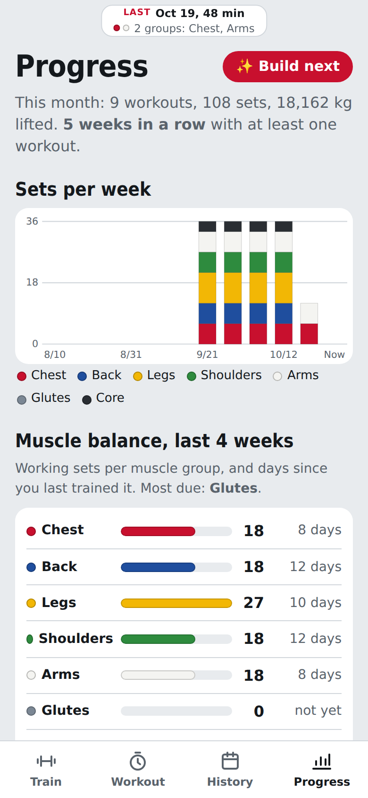<br><b>Progress</b><br><sub>Weekly sets and which muscles are most due.</sub></td><td align="center" valign="top" width="33%">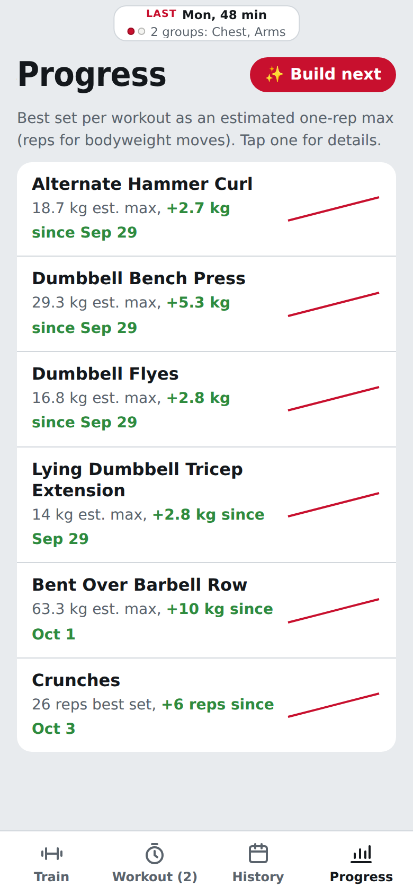<br><b>Your lifts</b><br><sub>Estimated one-rep max trend for each lift.</sub></td></tr>
</table>

### Make it yours

Settings apply instantly, and new versions arrive in the app.

- **Launch screen.** Go2FGym opens on its logo for 2.4 seconds: the dumbbell draws itself, then "Pick. Lift. Log." Tap to skip; with Reduce Motion it appears without movement. It is the shared [launch-screen](https://github.com/gadominas/app-blueprints/blob/main/blueprints/launch-screen.md) blueprint, so all the apps start the same way.

<table>
<tr><td align="center" valign="top" width="33%">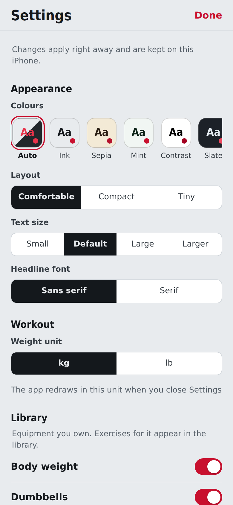<br><b>Settings</b><br><sub>Equipment, units, rest timer, colours and layout.</sub></td><td align="center" valign="top" width="33%">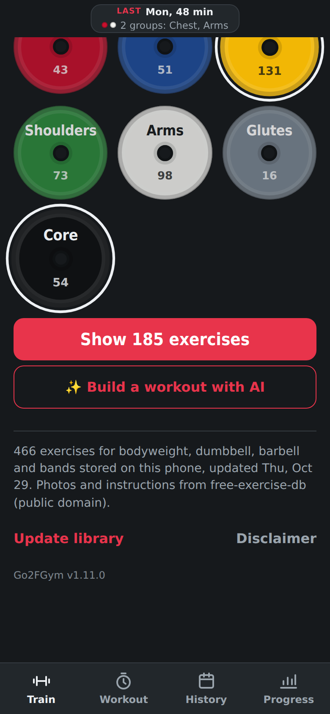<br><b>Light or dark</b><br><sub>Follows your iPhone, or pick one of six palettes.</sub></td><td align="center" valign="top" width="33%">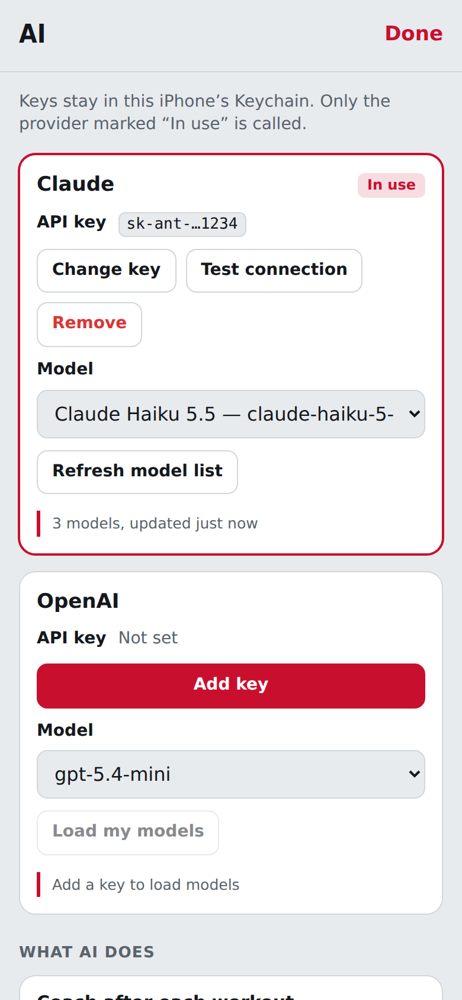<br><b>AI settings</b><br><sub>Claude or OpenAI, any model, token usage.</sub></td></tr>
<tr><td align="center" valign="top" width="33%">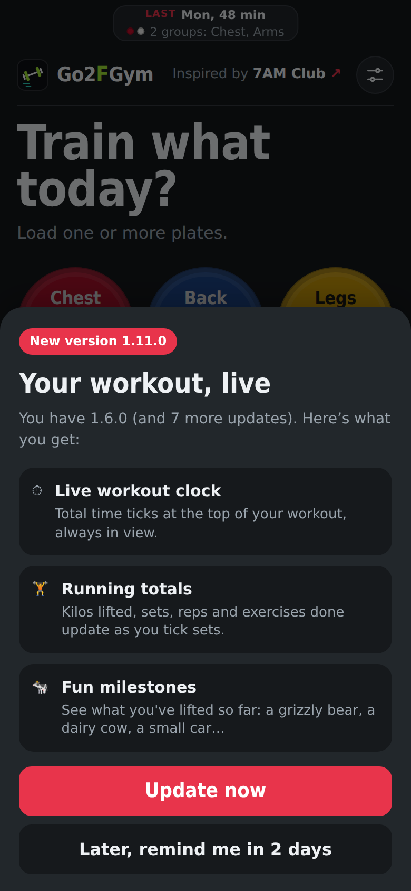<br><b>In-app updates</b><br><sub>New versions offered with their best features.</sub></td><td align="center" valign="top" width="33%"><br><b>Launch screen</b><br><sub>The dumbbell draws itself; tap to skip.</sub></td></tr>
</table>

## Setting up the AI coach

Uses Claude or OpenAI with **your own API key**. Everything else in the app works without it, and the AI buttons stay hidden until you add a key.

1. Create a key at [console.anthropic.com](https://console.anthropic.com/settings/keys) (Claude) or [platform.openai.com](https://platform.openai.com/api-keys) (OpenAI).
2. In Go2FGym tap the **sliders icon** on the Train tab, then **AI settings › Add key**. The key is typed into a native iOS prompt, stored in the iPhone's Keychain and only sent to its own provider. Here you can also pick any model your key can use, test the connection, and see your token usage per day, feature and model.
3. Pick what to train, your equipment, 20 to 60 minutes and Easy, Moderate or Hard, add a note if you like ("lower back is sore"), and tap **Build workout**.
4. Check the plan, then **Start this workout**. After **Finish workout** the AI coach reviews it and writes a Strava title and description. Both are saved with the workout in **History**.

Without a key, the Strava post's **Neutral** tone still works as a basic summary built on the phone, labelled “Template — no AI”. Everything the AI writes is labelled with the provider that wrote it. To stop the automatic review and Strava post after each workout, turn off the switch under **AI settings › What AI does**.

The AI only chooses exercises from your library, keeps weights at or close to what you lifted last time, and avoids loading anything you mention in the note. Check every weight anyway: it can be wrong.

**What's sent to the AI provider in use:** exercise names and muscles, your sets, weights and dates, the options you chose and your note. No name, account or location. Requests are billed to your own Claude or OpenAI account. Remove a key under **AI settings**.

This app follows the shared [app blueprints](https://github.com/gadominas/app-blueprints) (see [docs/BLUEPRINTS.md](docs/BLUEPRINTS.md)).

## Everyday use

| To… | Do this |
|---|---|
| Choose what to train | Tap one or more plates, then **Show exercises** |
| Narrow the list | Use the muscle, equipment and type chips, or search |
| See how it's done | Tap an exercise. **Start**, **Play** and **End** control the demo. |
| Add to today's workout | Tap **+** in the list, or **Add to workout** on the exercise |
| Add more during a workout | **＋ Add exercises** at the top of the Workout tab, tap **+**, then **✓ Workout** at the top to go back |
| Change the order of exercises | Drag the **⠿** handle, or tap **↑ Up next** on the one you want to do next |
| Finish an exercise | The round green **✓** in its top-right corner |
| Check a finished exercise | Tap its one-line summary to see the sets; **↺ Resume** to keep working on it |
| Quickly see how an exercise is done | Tap the **eye** next to it in your workout or a built plan; **Open exercise** for the full page |
| Log a set | Check weight and reps, then tap **✓**. Leave weight empty for bodyweight. |
| Add or remove a set | **Add set** copies the previous one; **×** removes a set |
| Finish | **Finish workout**, then tap again to save |
| Do a past workout again | **History**, open the workout, **Repeat this workout** |
| Let AI build a workout | **Train › ✨ Build a workout with AI** |
| Get your next workout in one tap | **✨ Build next** at the top of History or Progress. It uses the coach's last suggestion (or your most-due muscles), your usual workout length and all your equipment, and goes straight to the plan. **‹ Options** adjusts it; **Start ›** or **Start and add exercises** begins it. |
| Get AI feedback on a past workout | **History**, open it, **✨ Analyze with AI coach** |
| See your month | **History › Calendar**, tap a day; **‹ ›** change month |
| See your trends | **Progress** tab; tap a lift for its details |
| Post to Strava | **History**, open the workout, pick **Serious**, **Funny** or **Neutral** under *Strava post*, then **Copy both** |
| Export | **History › Export CSV** |
| Get new exercises or missing photos | **Train › Update library** (bottom of the Train screen) |
| Change look, units, equipment or rest time | The **sliders icon** at the top of the Train tab |
| Update the app | **Update now** on the update sheet, or **Settings › Updates › Check for updates now** |

## Settings

Tap the **sliders icon** at the top of the Train tab. Changes apply right away (no Save) and are kept in iCloud Drive › Scriptable › Go2FGym › `settings.json`; your workouts and library stay where they were.

| Section | What you can change |
|---|---|
| **Appearance** | Colours (Auto or six palettes, Go2FGym red in all), layout (Comfortable, Compact, or Tiny: one line per exercise without photos and one line per workout in History), text size, headline font (the condensed Go2FGym font or serif) |
| **Workout** | Weight unit, kg or lb (shown and exported) |
| **Library** | The equipment you own (body weight, dumbbells, barbell, bands, kettlebells, E-Z curl bar, medicine ball, exercise ball, foam roller, other) and whether strongman and Olympic weightlifting exercises are included. After adding equipment, tap **Update library** to download its photos |
| **History** | Back up history to iCloud Drive › Scriptable › Go2FGym-backup |
| **AI coach** | AI settings (keys, models, token usage, and the “after each workout” switch) and the default Strava post tone |
| **Updates** | Offer new versions (**Later** waits two days) and **Check for updates now** |
| **Timing, Downloads** | Rest timer length (30–300 s, default 90) and how many photos download at once (1–12, default 6), each with Reset |
| **Built with** | The [shared blueprints](https://github.com/gadominas/app-blueprints) this app follows (see [docs/BLUEPRINTS.md](docs/BLUEPRINTS.md)) |

## Updates and what's new

Go2FGym checks for a new version each time it opens. When there is one, a sheet shows its three best features with **Update now** and **Later** (asks again in two days). After updating, close the app and open it again. Your workouts and library are kept.

Every version is listed in the **[changelog](CHANGELOG.md)**. The version you have is shown at the bottom of the Train screen. To turn the checks off, switch off **Settings › Updates › Offer new versions**.

## Your data

- **Everything stays on your phone.** No account, no server, no tracking.
- Network use: downloading the exercise library from GitHub and, only if you add a key, the AI coach requests to Claude or OpenAI described above.
- History is a plain JSON file in Scriptable's folder, with a copy in iCloud Drive if enabled.

## Built with

- **[free-exercise-db](https://github.com/yuhonas/free-exercise-db)** by yuhonas: the exercise library (873 exercises with photos, steps, muscles and equipment), released into the public domain. Go2FGym downloads its `exercises.json` and photos once, then keeps them on your iPhone. It is based on **[exercises.json](https://github.com/wrkout/exercises.json)** by Ollie Jennings.
- **[Scriptable](https://scriptable.app)** by Simon B. Støvring: the iOS app that runs Go2FGym, providing the web view, files, Keychain and widgets.
- **[Claude API](https://www.anthropic.com/api)** (Anthropic) and **[OpenAI API](https://platform.openai.com)**: the optional AI coach, with your own key.
- **[GitHub](https://github.com/gadominas/Go2FGym)**: hosts the app, the one-line installer and `releases.json` for in-app updates.
- **[app-blueprints](https://github.com/gadominas/app-blueprints)**: shared patterns for Settings, AI configuration, in-app updates and the launch screen (see [docs/BLUEPRINTS.md](docs/BLUEPRINTS.md)). Go2FGym follows all four; **Settings › Built with** lists them with their versions, and docs/BLUEPRINTS.md adds the deviations.

No other libraries: the whole app is one file of plain JavaScript, HTML and CSS.

## Disclaimer

**Use Go2FGym and do these exercises entirely at your own risk.** The app gives general exercise information, not medical, physiotherapy or coaching advice, and the exercise data may contain mistakes. Check with a doctor before you start, especially if you have an injury or a health condition, are pregnant, or haven't trained for a while. Learn each movement with light weights, warm up, use safety stops or a spotter for heavy barbell work, and stop straight away if you feel pain, dizziness or shortness of breath.

Workouts, weights and analysis from the optional AI coach are generated automatically by a language model, can be wrong, and are no substitute for a qualified coach or doctor. Check every weight before you lift it.

To the fullest extent permitted by law, the author is not responsible or liable for any injury, health problem, loss or damage arising from using the app or doing the exercises. The app asks you to accept this on first launch.

## License

[MIT](LICENSE) © 2026 Gediminas Siutilas. Exercise data and photos are public domain.
